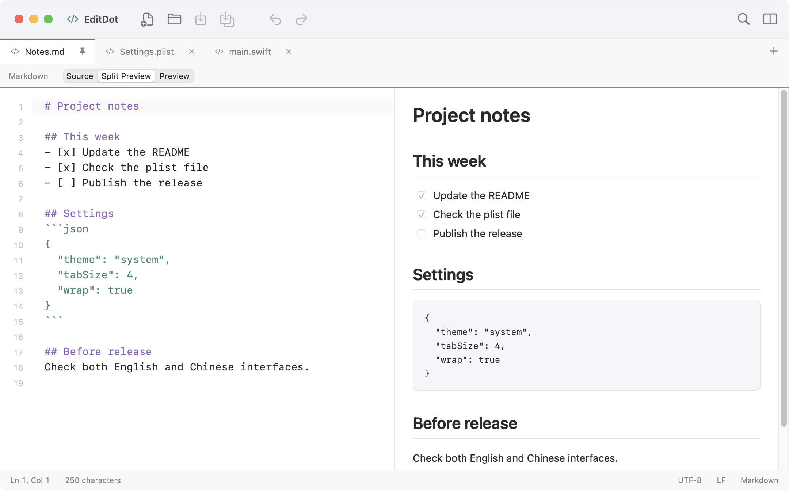

[简体中文](README.zh-CN.md)

# EditDot

EditDot is a lightweight, native text editor for macOS.



- Tabs, split views, draggable editor groups, and separate windows.
- Syntax highlighting, line bookmarks, text tools, and search across files.
- Markdown editing with live preview; XML and binary plist editing and validation.
- Multiple text encodings, file associations, and session recovery.
- Chinese and English interfaces, with light and dark appearances.

Files can be up to 32 MB. Syntax highlighting is disabled above 512 KB, and Markdown preview is limited to 2 MB. Raw HTML in Markdown is shown as text.

## Build and run

Requires macOS 12 or later and Xcode 14 or later. No dependency downloads are needed. The build targets your Mac's architecture.

```sh
bash scripts/build.sh
open outputs/EditDot.app
# Install or update the copy in Applications
bash scripts/install.sh
```

The local build uses an ad hoc signature and is not notarized.

## License

Licensed under GNU GPL version 3 only (`GPL-3.0-only`). See [LICENSE](LICENSE) and [NOTICE](NOTICE).

Markdown preview uses Marked 12.0.2, distributed under the [MIT license](Resources/Vendor/marked-LICENSE.md).

Copyright © 2017–2026 JamXi, JSG-LLC.
