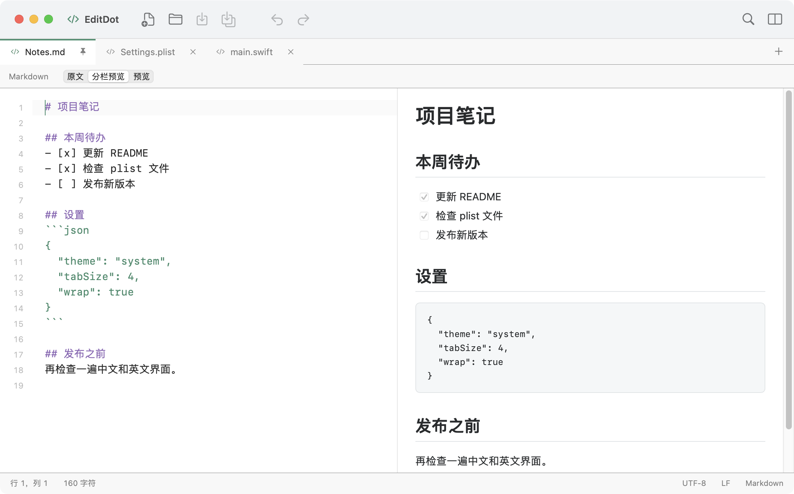

[English](README.md)

# EditDot

EditDot 是一款小巧的 macOS 原生文本编辑器。



- 多标签、分屏、拖动分组和独立窗口。
- 语法高亮、行书签、文本处理和跨文件查找。
- Markdown 编辑与实时预览，XML 和二进制 plist 编辑与校验。
- 多种文本编码、文件关联和会话恢复。
- 中英文界面，支持浅色和深色外观。

文件大小上限为 32 MB，超过 512 KB 时关闭语法高亮，Markdown 预览上限为 2 MB。Markdown 中的原始 HTML 按文本显示。

## 构建与运行

需要 macOS 12 或更新版本，以及 Xcode 14 或更新版本。无须下载依赖，默认构建当前 Mac 架构。

```sh
bash scripts/build.sh
open outputs/EditDot.app
# 安装或更新到应用程序文件夹
bash scripts/install.sh
```

本地构建采用临时签名，尚未进行分发公证。

## 许可

采用 GNU GPL 第 3 版许可，仅限该版本（`GPL-3.0-only`）。详见 [LICENSE](LICENSE) 和 [NOTICE](NOTICE)。

Markdown 预览使用 Marked 12.0.2，遵循 [MIT 许可证](Resources/Vendor/marked-LICENSE.md)。

Copyright © 2017–2026 JamXi, JSG-LLC.
